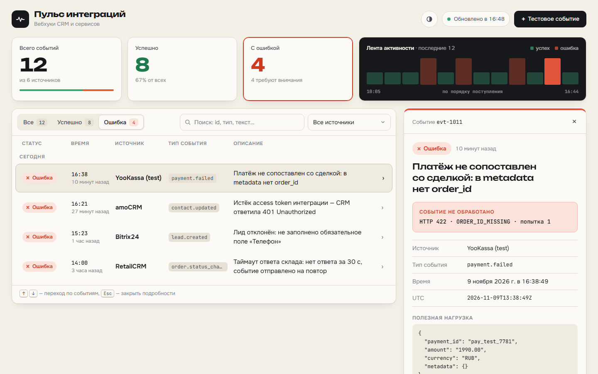
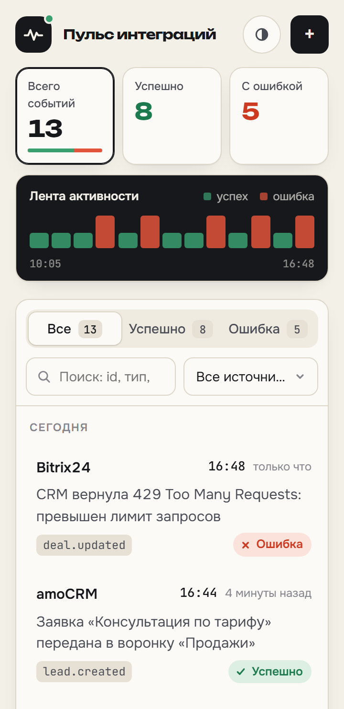
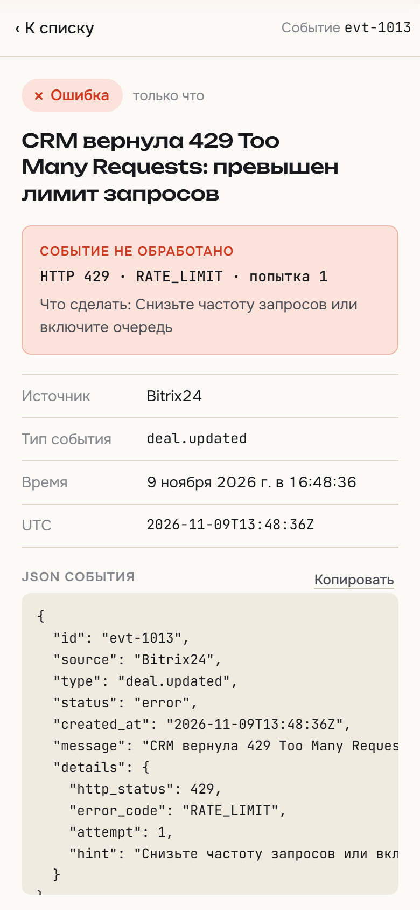
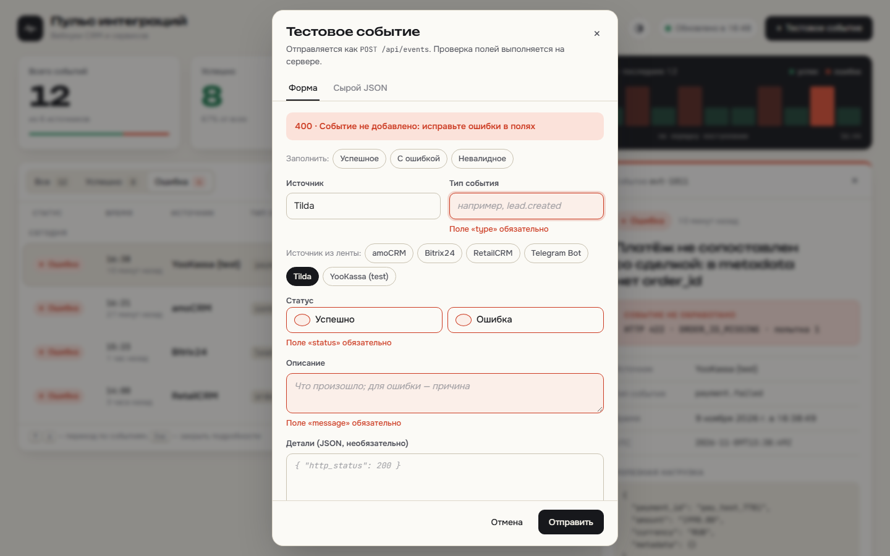
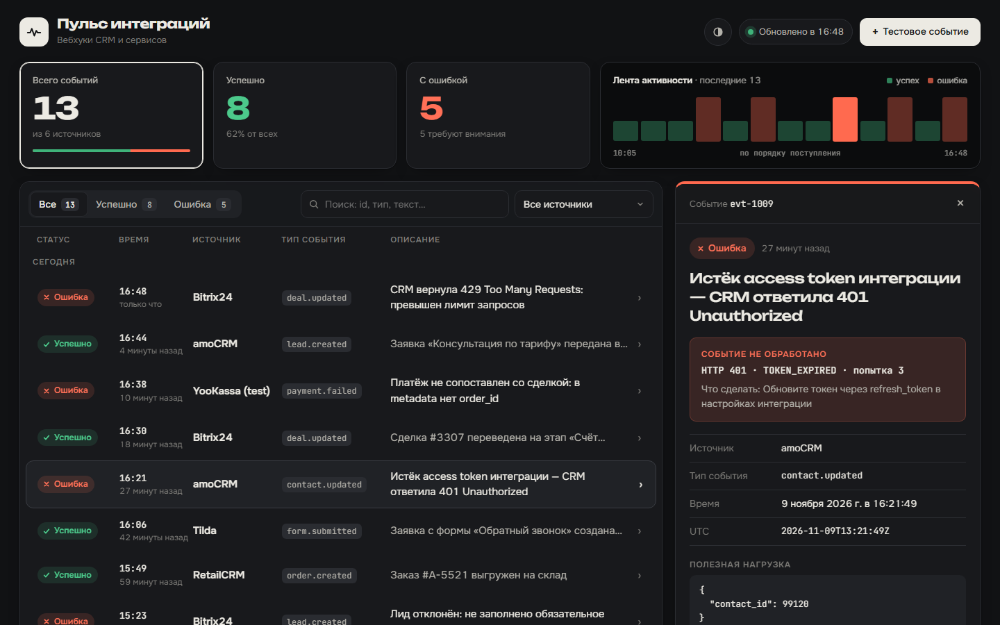

# Пульс интеграций

Небольшой сервис для мониторинга вебхуков от CRM и других систем. Открываешь страницу и сразу видишь, сколько событий прошло, где ошибки и что именно сломалось в каждом случае.



<p>
  
  
  
</p>



## Как запустить

Нужен Node.js 20.19 или новее (проверял на 22 и 26).

```bash
npm install
npm run dev
```

Интерфейс откроется на http://localhost:5173, API работает на http://localhost:3001/api/events.

Если нужен один порт для всего:

```bash
npm run build
npm start        # http://localhost:3001
```

Или через Docker:

```bash
docker compose up --build   # http://localhost:3001
```

## Проверки

```bash
npm test             # 22 теста API (vitest + supertest)
npm run test:e2e     # 18 браузерных тестов: десктоп и телефон (Playwright)
npm run typecheck    # TypeScript
npm run demo         # показывает успешный POST и ошибки валидации на запущенном сервере
```

Перед первым `npm run test:e2e` нужно один раз скачать браузер: `npx playwright install chromium`. Тесты сами собирают проект и поднимают сервер на порту 3005.

## Стек

Сервер: Node.js, Express 5, zod 4 для валидации, запуск через tsx.
Интерфейс: React 19, Vite 8, TypeScript и обычный CSS (переменные, container queries, светлая и тёмная тема). Без UI-библиотек.
Шрифты: Onest для текста, Unbounded для цифр и заголовков, JetBrains Mono для данных. Подключены через @fontsource, без CDN.
Тесты: vitest и supertest для API, Playwright для интерфейса.
Данные хранятся в памяти. При старте загружаются 12 тестовых событий (8 успешных, 4 с ошибкой) от выдуманных интеграций.

## Что сделано

Интерфейс:

- Статистика: всего, успешно, с ошибкой и доля успешных. По клику на карточку включается соответствующий фильтр.
- Лента активности: последние события цветными столбиками, ошибки выше и красные. Клик по столбику открывает событие.
- Список событий с временем (точным и «5 минут назад»), источником, типом, статусом и описанием. События сгруппированы по дням. У ошибок причина видна в две строки, чтобы её не приходилось открывать.
- Фильтр «Все / Успешно / Ошибка» со счётчиками, поиск по id, источнику, типу и тексту, выпадающий список источников с количеством событий и ошибок.
- Подробности события. На компьютере это панель справа, на планшете выезжающая панель, на телефоне отдельный экран с кнопкой «К списку». У ошибки показаны HTTP-код, код ошибки, номер попытки и подсказка, что делать. Ниже payload вебхука, полный JSON и кнопка «Копировать cURL», чтобы повторить запрос.
- Форма тестового события отправляет `POST /api/events`. Ошибки от сервера появляются под нужными полями. Есть готовые варианты «Успешное», «С ошибкой», «Невалидное» и режим «Сырой JSON» для любых проверок.
- Список обновляется сам каждые 5 секунд, пока вкладка открыта. Событие, отправленное через curl или Postman, появляется без перезагрузки и ненадолго подсвечивается.
- Фильтры и открытое событие сохраняются в адресе страницы. Ссылку можно отправить коллеге, после перезагрузки ничего не теряется, а кнопка «Назад» на телефоне закрывает подробности.
- Клавиатура: j/k и стрелки переключают события, Esc закрывает подробности. Есть ссылка «к списку событий» для перехода с клавиатуры, видимый фокус и поддержка `prefers-reduced-motion`.
- Светлая и тёмная тема. По умолчанию берётся системная, кнопкой в шапке можно выбрать вручную, выбор запоминается.
- Вёрстка проверена от 360 px до широких экранов. Список сам переключается между таблицей и карточками в зависимости от доступной ширины.
- Состояния загрузки, пустого результата, недоступного API и «событие по ссылке не найдено» тоже оформлены.

Сервер:

- `GET /api/events` отдаёт список, новые сверху. Можно фильтровать: `?status=error`, `?source=amoCRM`, `?limit=50`.
- `GET /api/events/:id` отдаёт одно событие.
- `POST /api/events` проверяет событие и добавляет его. Отвечает `201` и заголовком `Location`.

## API

Событие выглядит так:

```json
{
  "id": "evt-1001",
  "source": "amoCRM",
  "type": "lead.created",
  "status": "success",
  "created_at": "2026-11-02T12:15:00Z",
  "message": "Заявка успешно передана",
  "details": { "http_status": 200, "payload": { "lead_id": 48211 } }
}
```

Правила для `POST /api/events`:

| Поле | Обязательно | Правило |
|---|---|---|
| `source` | да | непустая строка до 64 символов |
| `type` | да | непустая строка до 64 символов |
| `status` | да | `success` или `error` |
| `message` | да | до 500 символов. Если статус `error`, здесь пишется причина, не короче 10 символов |
| `id` | нет | если не передать, сервер создаст `evt-NNNN`. Латиница, цифры и `._-`, до 64 символов. Повторный id вернёт `409` |
| `created_at` | нет | дата ISO 8601 с часовым поясом, по умолчанию текущее время. Сервер переводит её в UTC. Даты раньше 2000 года и позже чем через сутки не принимаются |
| `details` | нет | объект с любыми подробностями: HTTP-код, payload, номер попытки |

Лишние поля не принимаются. Если опечататься и написать `staus`, сервер вернёт ошибку, а не сохранит событие без статуса. Пробелы по краям строк обрезаются, поэтому строка из одних пробелов считается пустой.

Коды ответов: `201` событие создано, `400` ошибка валидации или битый JSON, `409` такой id уже есть, `413` тело больше 64 КБ, `415` тело не в JSON. Ошибки всегда приходят в одном формате:

```json
{
  "error": "validation_error",
  "message": "Событие не добавлено: исправьте ошибки в полях",
  "fields": [{ "field": "type", "message": "Поле «type» обязательно" }]
}
```

### Пример: успешный запрос и ошибка валидации

Проще всего запустить `npm run demo`, пока работает сервер. Скрипт работает одинаково на Windows, macOS и Linux. То же самое через curl:

```bash
curl -i -X POST http://localhost:3001/api/events \
  -H "Content-Type: application/json" \
  -d '{"source":"amoCRM","type":"lead.created","status":"success","message":"Заявка успешно передана"}'
```

```
HTTP/1.1 201 Created
Location: /api/events/evt-1013

{"id":"evt-1013","source":"amoCRM","type":"lead.created","status":"success","created_at":"2026-11-09T13:25:41Z","message":"Заявка успешно передана"}
```

```bash
curl -i -X POST http://localhost:3001/api/events \
  -H "Content-Type: application/json" \
  -d '{"source":"Bitrix24","status":"pending"}'
```

```
HTTP/1.1 400 Bad Request

{"error":"validation_error","message":"Событие не добавлено: исправьте ошибки в полях","fields":[
  {"field":"type","message":"Поле «type» обязательно"},
  {"field":"status","message":"Поле «status» должно быть «success» или «error»"},
  {"field":"message","message":"Поле «message» обязательно"}]}
```

Через интерфейс: «+ Тестовое событие», затем «Невалидное» и «Отправить». Под полями появятся ошибки от сервера. Потом «С ошибкой» и «Отправить»: событие встанет первым в списке и сразу откроется.

## Допущения

- `id` и `created_at` в POST необязательны. В настоящем приёмнике вебхуков их обычно ставит сервер. Если их передать, сервер проверит и сохранит их.
- Обязательные поля: `source`, `type`, `status` и `message`. Без них событие нельзя нормально показать в списке.
- Карточки статистики считают все события. Счётчики на вкладках фильтра учитывают выбранный источник и поиск, поэтому совпадают с тем, что видно в списке.
- Если фильтр прячет открытое событие, подробности закрываются, чтобы панель не показывала то, чего нет в списке.
- Данные живут в памяти и сбрасываются при перезапуске, ТЗ это разрешает. В хранилище помещается до 1000 событий, при переполнении удаляются самые старые.
- Список обновляется опросом раз в 5 секунд. Для прототипа это проще SSE или WebSocket, а сценарий «отправил curl и увидел событие» работает.

## Ограничения

- Нет постоянного хранилища. После перезапуска остаются только 12 стартовых событий.
- Нет пагинации и виртуализации списка. Для прототипа не нужно, но API уже понимает `limit`.
- Нет авторизации, её не требовалось.
- Браузерные тесты проверяют основные сценарии, но не каждую мелочь интерфейса. Внешний вид дополнительно проверялся по скриншотам.

## Структура проекта

```
server/
  app.ts          маршруты API, обработка ошибок, раздача собранного фронтенда
  schema.ts       правила валидации (zod) и сообщения об ошибках
  store.ts        хранилище в памяти: сортировка, фильтры, id, лимит
  seed.ts         12 тестовых событий
  index.ts        точка входа
shared/types.ts   общий тип события для сервера и интерфейса
src/
  App.tsx         экран целиком, фильтрация, клавиатура
  useEvents.ts    загрузка, автообновление, подсветка новых событий
  useUrlState.ts  фильтры и открытое событие в адресе страницы
  components/     StatsPanel, Toolbar, SourceSelect, EventList, EventDetail, NewEventDialog, StatusBadge
  styles.css      цвета, темы, адаптивная вёрстка
tests/            тесты API
e2e/              браузерные тесты
scripts/demo.mjs  демонстрация API
```

## Как я использовал AI

Работал в Claude Code. Код писал он по моим постановкам, а решения и проверку я держал за собой.

Что решал сам. Стек: один репозиторий с Express и Vite, чтобы проверяющему хватило одной команды. Формат события и правила валидации: какие поля обязательны, почему лишние поля отклоняются, приведение времени к UTC, 409 на повторный id, минимальная длина причины для ошибки. Устройство экрана и визуальный стиль «диспетчерского журнала». Что оставить за рамками прототипа.

Что отдавал AI. Код по этим решениям, тесты, стили по заданным цветам и шрифтам, демо-скрипт.

Как проверял. После каждого этапа запускал тесты и проверку типов. Сценарии прогонял в браузере через Playwright на компьютере, планшете и телефоне и смотрел скриншоты. Собирал и запускал проект в Docker и из чистого клона. Интерфейс прогнал по чек-листу Web Interface Guidelines и через детектор типичных шаблонов сгенерированного дизайна. После этого убрал декоративную сетку на фоне и цветные полоски на карточках, заменил системный выпадающий список и синюю обводку фокуса на свои. Код отдельно посмотрели два независимых ревьюера: один искал баги, второй оценивал работу как проверяющий по критериям ТЗ.

Что нашлось при проверке:
- Если поменять фильтр при открытом событии, Esc возвращал старые фильтры. Теперь шаг назад по истории делается, только если предыдущая запись совпадает с текущим списком.
- Опоздавший ответ автообновления мог на несколько секунд стереть только что добавленное событие. Теперь устаревшие ответы отбрасываются по номеру запроса.
- Пустой POST отвечал 415 вместо 400 со списком недостающих полей.
- При заполненном хранилище могло вытесниться только что принятое событие.
- Дата из далёкого будущего навсегда застревала вверху ленты.
- Длинное слово без пробелов растягивало панель подробностей на телефоне.
- На планшете таблица была слишком тесной. Теперь там карточки и выезжающая панель.

## Самое удачное решение

Правила валидации описаны в одном месте, в схеме на сервере. Ошибки возвращаются списком по полям, и форма просто раскладывает их под нужными полями. Интерфейс не дублирует проверки, а curl, CRM и форма получают одинаковый понятный ответ, даже если ошиблись в имени поля. Ещё мне нравится, что фильтры и открытое событие живут в адресе страницы: ссылку на конкретную ошибку можно сразу отправить коллеге, а на телефоне привычный жест «Назад» закрывает подробности.
